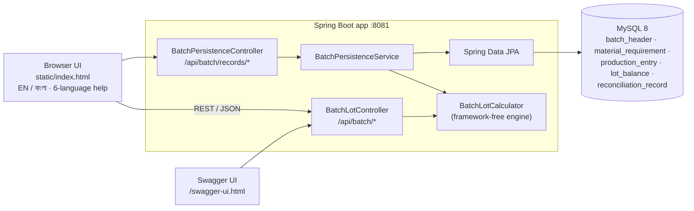
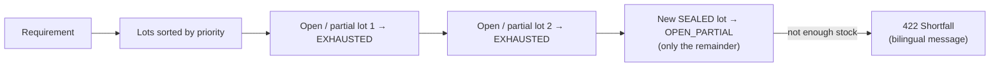

<div align="center">

# 🧮 RbcTcsWorld Pharmaceutical Production Management Calculator

### Batch / lot calculator for pharmaceutical packaging lines — Spring Boot REST API, MySQL batch records, bilingual browser UI, tested from unit to Selenium

[](https://git.io/typing-svg)

<!-- ============ STATUS BAR ============ -->
[](https://github.com/rbchy/RbcTcsWorld_Pharmaceuticals_PMC/actions/workflows/ci.yml)


</div>

---

## 📌 At a Glance

<table>
<tr>
<td width="50%" valign="top">

**🙋 What this is**

A REST-API-first calculator for the numbers a blister-packaging line lead works out on every batch:

- **pack hierarchy:** caplets → BFUs → cartons → bundles → shippers
- **material requirement** with standard overage
- **partial-production progress** across shifts, with each shift classed as **Startup / Running / Finished**
- **Sealed vs Exhaust lot allocation:** open lots are used up before a new sealed lot is touched
- **material reconciliation** within a tolerance

It is modelled on a real packaging work order. Batch records can be saved to MySQL. The whole thing is usable from a bilingual (English / বাংলা) browser UI, with a 6-language Help Center and a GMP / cGMP / EHS / OEB glossary.

Every push runs the **unit, API and Selenium E2E** tests in GitHub Actions. The E2E tests run against the app on a real MySQL database.

</td>
<td width="50%" valign="top">

**📍 Quick facts**

| | |
|---|---|
| 🧩 **API** | 6 calculator + 8 batch-record endpoints |
| 🧪 **Tests** | 27 unit · 42 API (MockMvc) · 12 Selenium E2E |
| ✅ **CI** | 81 / 81 + MySQL round trip · ≈ 2.5 min |
| 💾 **Database** | MySQL 8, 5 tables · H2 for tests |
| 📖 **Docs** | Swagger UI at `/swagger-ui.html` |
| 📊 **Reports** | Allure (by layer and severity) · Surefire |
| 🗂️ **Test design** | ~150-case matrix in `RbcTcsWorld_Test_Cases.xlsx` |

</td>
</tr>
</table>

---

## ✅ Latest Results

| Layer | Tests | What is asserted | Result |
|---|---:|---|---|
| 🧩 Unit (`BatchLotCalculatorTest`) | 27 | Hierarchy math and whole shippers · overage · progress capped at 100 % · Sealed vs Exhaust order and shortfall · Startup / Running / Finished · tolerance boundary is inclusive · **negative inputs refused** |  |
| 🌐 Stateless API (`/api/batch/*`) | 26 | Every calculator endpoint, positive and negative · 400 on invalid input · 405 / 404 on a wrong method or path · script tags treated as plain text · very large numbers do not overflow |  |
| 💾 Persisted API (`/api/batch/records/*`) | 16 | Full life cycle: create → production → lot allocation → reconciliation → read → delete · unknown batch → 404 · **an entry of another batch cannot be deleted** · negative quantities → 400 |  |
| 🖥️ Selenium E2E (headless Chrome) | 12 | Login / register and their validation · 7 dashboard tiles · Hierarchy add / edit / reset / display · language persists across reload · Arabic Help Center is right-to-left |  |
| 🐬 MySQL round trip (CI) | — | Create → read → delete a batch record on MySQL 8 |  |
| **Total** | **81** | | **100 %** |

<sub>GitHub Actions: job 1 runs unit + API tests on H2 and builds the Allure report; job 2 starts the app on a MySQL 8 service and runs the Selenium suite in headless Chrome ([workflow](.github/workflows/ci.yml)).</sub>

---

## 🏗️ Architecture



### Sealed vs Exhaust allocation



---

## 🧩 API

| Endpoint | Purpose |
|---|---|
| `POST /api/batch/hierarchy` | Cartons → BFUs, caplets, bundles, shippers |
| `POST /api/batch/material-requirement` | Base + overage = quantity to issue, per material |
| `POST /api/batch/progress` | Produced, rejected, remaining, % complete |
| `POST /api/batch/lot-type` | Startup / Running / Finished per shift entry |
| `POST /api/batch/lot-allocation` | Sealed vs Exhaust allocation, with shortfall detection |
| `POST /api/batch/reconciliation` | Used / rejected / return-to-store per material, against the tolerance |
| `POST /api/batch/records` · `GET /api/batch/records` · `GET /{id}` · `DELETE /{id}` | Saved batch records |
| `POST /{id}/production` · `DELETE /{id}/production/{entryId}` | Shift entries (append-only) |
| `POST /{id}/lot-allocation` · `POST /{id}/reconciliation` | Save an allocation or reconciliation with the batch |

Error responses are JSON:

| Status | When |
|---|---|
| **400** | Validation failure or a negative quantity |
| **404** | Unknown batch, or an entry that is not in this batch |
| **422** | Lot shortfall |

---

## 🛠️ Tech Stack

| Layer | Technology | Version |
|---|---|---|
| Language | Java | 17 |
| Framework | Spring Boot (Web, Data JPA, Validation) | 3.3.4 |
| Database | MySQL (Connector/J) · H2 for tests | 8 |
| API docs | springdoc-openapi | 2.6.0 |
| Frontend | One HTML / CSS / vanilla JS file, served by Spring Boot, no build step | — |
| Tests | JUnit 5 · Spring MockMvc · Selenium 4 + WebDriverManager | 4.23.0 |
| Reporting | Allure (`@Epic` = layer, `@Severity` = matrix priority) + AspectJ | 2.29.0 |
| CI | GitHub Actions with a MySQL 8 service and headless Chrome | — |

---

## 📁 Project Structure

```
RbcTcsWorld_Pharmaceuticals_PMC/
├── .github/workflows/ci.yml             ← unit + API (H2) → app on MySQL → Selenium E2E
├── src/main/java/com/sharp/batchcalc/
│   ├── BatchLotCalculator.java          core engine (no Spring), input checks
│   ├── BatchConfig, MaterialRequirement, ProductionEntry, LotBalance, …   models
│   ├── Main.java                        console demo
│   ├── web/                             stateless REST API, DTO validation, error handler
│   └── persistence/                     batch-record REST API, JPA entities, repositories
├── src/main/resources/
│   ├── application.properties           MySQL settings from DB_* environment variables
│   └── static/index.html                the whole browser UI
├── src/test/java/com/sharp/batchcalc/
│   ├── BatchLotCalculatorTest.java      unit
│   ├── web/                             stateless API tests
│   ├── persistence/                     persisted API tests (H2)
│   └── e2e/                             Selenium Page Objects + CriticalJourneysE2ETest
├── RbcTcsWorld_Test_Cases.xlsx          ~150-case test design matrix
├── run.sh                               starts the app (asks for the DB password)
└── pom.xml
```

---

## ⚙️ Getting Started

**Prerequisites:** JDK 17+ · Maven · MySQL 8 (only for saved batch records) · Chrome (for E2E)

```bash
git clone https://github.com/rbchy/RbcTcsWorld_Pharmaceuticals_PMC.git
cd RbcTcsWorld_Pharmaceuticals_PMC

export DB_USER=root
export DB_PASSWORD='your-mysql-password'    # or let run.sh ask for it
./run.sh                                    # creates batch_lot_calc if missing
```

Open **http://localhost:8081/** for the UI, or **http://localhost:8081/swagger-ui.html** for the API.

| Run | Command |
|---|---|
| Unit + API tests (H2, no MySQL) | `mvn test` |
| Allure report | `mvn io.qameta.allure:allure-maven:serve` |
| Selenium E2E (app must be running) | `mvn test -Dtest='com.sharp.batchcalc.e2e.**' -Dsurefire.failIfNoSpecifiedTests=false` |
| Console demo, no Spring | `mvn compile exec:java` |

---

## 🔄 How It Compares to PPES

[PPES — Pharmaceutical Packaging Management System](https://github.com/rbchy/PPES-Pharmaceutical-Packaging-Management) is the author's broader packaging system: a Java Swing desktop app and a PHP web app on an 18-table MySQL database, with real authentication and Excel reports. This project goes deeper into one capability.

| | **PPES** | **This calculator** |
|---|---|---|
| Scope | Whole packaging-line ERP | Batch / lot math, lot allocation, reconciliation |
| Architecture | Swing + PHP apps, both talking to MySQL directly | One Spring Boot app; the UI calls a documented REST API |
| Lot allocation | Not modelled | Sealed vs Exhaust, with shortfall detection |
| Shift classification | Shift log only | Startup / Running / Finished per entry |
| Authentication | Real (salted SHA-256) | Demo only (browser storage) |
| Reports | 6 Excel reports | JSON API + on-screen tables + Allure test report |
| Automated tests | None | 81 in CI: unit, API, Selenium |

---

## 🧹 Maintenance Log

| Change | Why |
|---|---|
| Negative quantities are refused, both in the request DTOs and in the engine (400) | A −5 % overage issued **less** material than needed. A −10 reject **increased** the return-to-store figure. Negative cartons gave −2 shippers. The tests documented this as accepted behaviour |
| `DELETE /records/{id}/production/{entryId}` checks that the entry belongs to the batch (404 otherwise) | Any batch's URL could delete another batch's production record |
| Fail-fast constructor in `BatchLotCalculator` | A missing config only failed later with a bare `NullPointerException` |
| 6 new API tests for those fixes; the 4 "documents current behaviour" tests now assert the fix | Each gap is now guarded by a test |
| E2E page object reads tile titles with `textContent` | The UI starts in Bangla, so the English titles are hidden and `getText()` returned "". **5 of 12 E2E tests failed** the first time they ran in CI |
| `run.sh` no longer contains a database password | It held a hard-coded MySQL root password; it now reads `DB_PASSWORD` or asks |
| GitHub Actions: unit + API with Allure, then E2E against MySQL | There was no CI; the E2E tests had never run automatically |
| README updated | The old one linked a `DEVELOPMENT.md` that is not in the repo, asked for a LICENSE that already exists, and listed the gaps fixed above |

### Remaining known gaps

- Login and Register are **demo only** (browser storage), not backend authentication.
- Production entries are **append-only**. Re-sending the same entries creates duplicates; a test documents this on purpose.
- A material with no usage entry is reconciled at its theoretical quantity (0 % variance) instead of being flagged as missing.
- The Español / Français / العربية / 中文 Help Center texts should be reviewed by native speakers before real GMP use.

---

## 📈 Roadmap

- [x] Input hardening, batch-scoped deletes, CI with unit / API / E2E
- [ ] Spring Security with real users and roles (port from PPES)
- [ ] Flag missing usage data in reconciliation instead of assuming theoretical
- [ ] Idempotent production entries (shift + date key)
- [ ] Flyway migrations instead of `ddl-auto=update`
- [ ] Excel export of a batch record (Apache POI)
- [ ] Publish the Allure report to GitHub Pages

---

## 🔗 Related Projects

| Project | Stack |
|---|---|
| 💊 [PharmaPack QMS — Serialization & Line Control](https://github.com/rbchy/RbcTcsWorld_PharmaPackQMS_Serialization) | Spring Boot · React · L3 serialization · 77 / 77 in CI |
| 💊 [PharmaPack QMS](https://github.com/rbchy/RbcTcsWorld_PharmaPackQMS) | Spring Boot QMS: AQL, deviations, CAPA, reconciliation · 66 / 66 in CI |
| 🧬 [RbcTcsWorld ClinTrial Connect](https://github.com/rbchy/RbcTcsWorld_ClinTrial-Connect) | Clinical-trial platform with its own test suite |
| ⭐ [RbcTcsWorld E-Commerce Suite](https://github.com/rbchy/RbcTcsWorld_ECommerceSuite) | Spring Boot · REST Assured · Selenium · Playwright · CI quality gates |

<sub>All projects: [github.com/rbchy](https://github.com/rbchy)</sub>

---

## ⚠️ Disclaimer

This is a **portfolio / training project** built from hands-on GMP packaging experience. It is **not** a validated GxP system. Quantities and tolerances must follow your site's SOPs and approved batch records.

---

## 👤 Author

<div align="center">

**Ranajit Baran Chowdhury (RB Chowdhury)**
QA Automation Engineer / SDET · Pharmaceutical Packaging Production (GMP) · West Norriton, Pennsylvania, USA

[](https://www.linkedin.com/in/rbchy/)
[](https://github.com/rbchy)
[](https://rbchy.github.io/rbchy/)
[](https://rbc6543.wixsite.com/rbc-portfolio)
[](mailto:chyranajit@gmail.com)

<sub>MIT licensed — see [LICENSE](LICENSE).</sub>

⭐ *If this project helps you, a star on the repo is appreciated.*

</div>
